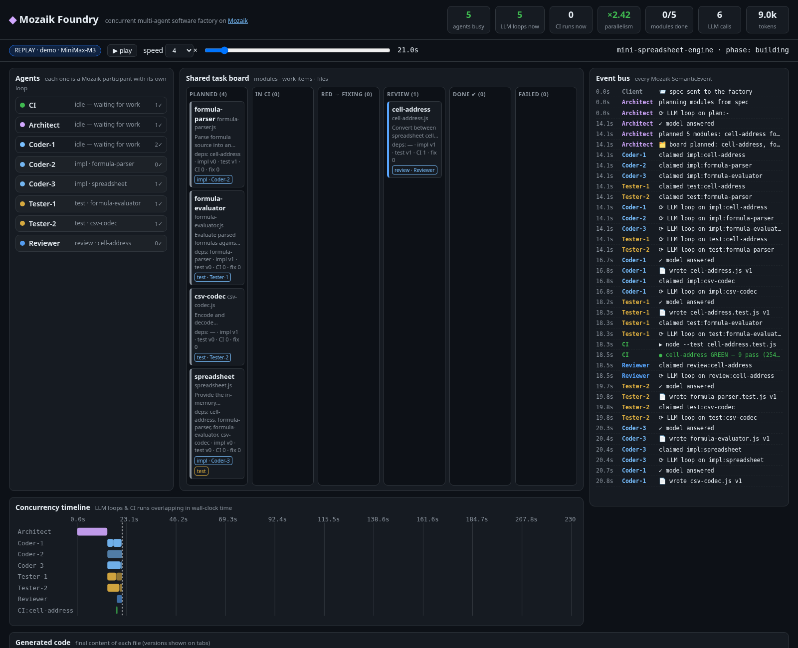

# Mozaik Foundry

**A concurrent, multi-agent software factory built on [Mozaik](https://github.com/jigjoy-ai/mozaik) (`@mozaik-ai/core`).**
Give it a plain-English spec; an Architect agent splits it into modules with explicit contracts, then
**three Coders, two Testers, a Reviewer and a CI runner work on the same shared board at the same time**:
coders implement while testers write tests for the *same contracts* in parallel, CI runs `node --test`
as soon as both halves exist, red builds route back to the right agent, and the run ends with a green,
runnable JavaScript package plus a full event log you can replay in a web UI.

> Built during the JigJoy Mozaik hackathon (Freestyle track). LLM: MiniMax (`MiniMax-M3`) via its
> OpenAI-compatible endpoint, plugged into Mozaik's own `OpenAIChatCompletions` adapter.

- Live demo (replay of a recorded run, no key needed): **https://mozaik-foundry.vercel.app**
- Screenshots: [`docs/screenshots/`](docs/screenshots)



## What it does

```
spec.md ──► Architect ──► plan (modules + contracts + deps)
                              │  board.planned
          ┌───────────────────┼────────────────────┐
     impl:A impl:B impl:C   test:A test:B test:C    (work items on the shared board)
          │   claimed concurrently by Coder-1..3 and Tester-1..2
          ▼                                         ▼
     A.js, B.js, C.js   ──── artifact.submitted ──► A.test.js …
                              │
                         CI (node --test, up to 4 suites in parallel)
                     green ──► review ──► done        red ──► fix (back to the coder who wrote it)
                                                      stuck/broken test ──► fixtest (to the test author)
```

Output lands in `runs/<name>/workspace/` (a real package: `npm test` works there) plus
`runs/<name>/run.json` (every event, for the UI) and `runs/<name>/cassette.json` (every LLM answer, for free replay).

The spec is just a Markdown file, so the same factory builds different software:
`specs/spreadsheet.md` (formula engine with dependency recalculation, cycles, CSV) and
`specs/markdown.md` (Markdown → HTML renderer). Point `--spec` at any new task.

## How the agents run concurrently

- Every role is a Mozaik participant (`createAgent` for LLM roles, `createHuman` for CI, the Client and the Observer) joined to **one runtime** (`defineRuntime`).
- Agents react to bus events through `SituationHandler`s (a `SituationSpecification` + `SituationProcessor`). On any wake event (`board.planned`, `board.changed`, `artifact.submitted`, `ci.finished`, …) each idle agent tries to **claim** a work item.
- A claimed item starts a Mozaik `runLoop(...)` with a fresh, task-scoped `ModelContext`. `runLoop` is fire-and-forget, so the processor returns immediately and **all agents' inference loops are in flight at once** — the CLI shows `busy=5` and the UI's Gantt chart shows overlapping LLM bars. The recorded demo peaked at **6 concurrent LLM loops** with **×1.41–×1.78 parallelism** (summed agent work ÷ wall-clock).
- When an agent's own model answer arrives (`OwnAnswerSpecification`), its second handler applies the result (writes the file, files a review, …), marks the item done and publishes `board.changed`, which wakes everyone else.
- CI runs test suites as child processes, several modules at once, so testing overlaps with coding.

## Recorded results (MiniMax-M3, spec `specs/spreadsheet.md`)

| run | modules | done | tests | wall | parallelism | peak LLM loops | calls / tokens |
|---|---|---|---|---|---|---|---|
| `runs/demo-v1` (web UI default) | 5 | 4 | 37 pass / 1 fail | 230.9 s | ×1.41 | 6 | 28 / 101.9k |
| `runs/demo` (latest code; `npm run replay`) | 4 | 3 | 25 pass / 5 fail | 70.8 s | ×1.65 | 6 | 18 / 65.0k |

The leaf modules (cell addresses, formula parser/evaluator, CSV codec) go green and get reviewed; the top-level
`spreadsheet` integration module is the hardest part and failed within the fix budget in both runs (a real
`#CYCLE` propagation bug in v1; an API-shape disagreement between coder and tester in the latest run). The
factory reports that honestly (`RELEASE INCOMPLETE`) instead of looping. Since v1 it also gives fixers the real
source of already-green dependencies and asks the Architect for exact data shapes in contracts.

Web UI: `/?run=runs/demo.json` (v1) or `/?run=runs/latest.json` (latest).

## Shared state

`FoundryState` (a Mozaik `RuntimeState` subclass, `src/board.ts`) is the blackboard every participant reads and writes:

| field | contents |
|---|---|
| `modules` | plan: id, file, contract, deps; status (`planned → ci → red/green → review → done/failed`), authors, fix/review rounds, last failure count |
| `work` | work items: `impl / test / fix / fixtest / review`, status `open → claimed → done`, assignee, preferred assignee, retry notes, attempt, timestamps |
| `files` | versioned artifacts (content + author + version) mirrored to disk |
| `workers` | each agent's role, `idle/busy`, current item, completed count |
| budget | LLM calls and tokens spent vs. caps (`--max-calls`, `--max-tokens`) |

## Coordination

- **Atomic claims.** Mozaik's `publish` delivers events synchronously, and `tryClaim` checks-and-sets an item in one synchronous step, so two agents woken by the same event can never take the same item — no locks needed.
- **Ownership.** `fix` items carry `preferredAssignee` = the coder who wrote the file; `fixtest` goes to the test author. Others only take an item if its owner is gone.
- **Contracts first.** Coders and testers work from the Architect's contract, never from each other's code, so they can run in parallel; CI is the referee.
- **Arbitration.** If a test file doesn't even load, or the coder has failed to make progress twice, CI routes the next red build to the *tester* with the implementation as evidence (alternating with the coder so neither side loops forever).
- **Self-check.** Each agent syntax-checks its own output (`node --check`) and rejects truncated answers, re-queueing the item for itself with a note (max 3 attempts).
- **Budget & watchdog.** Shared call/token caps; a release gate ends the run when every module is terminal (`done`/`failed`).
- **Observability.** An Observer participant records every bus event to `run.json`; the CLI prints a timestamped log with live `busy=` counts.

## How to run

Requires Node ≥ 20.

```bash
npm install

# 1) Free: replay the recorded demo run (no API key; same timing as the live run)
npm run replay            # then open http://localhost:4321/?live=1

# 2) Live, with MiniMax
export MINIMAX_API_KEY=...            # never committed; read from the environment
npx tsx src/main.ts --spec specs/spreadsheet.md --name myrun --ui
npx tsx src/main.ts --spec specs/markdown.md                 # a different product, same factory

# 3) Just the web UI over a recorded run
npm run ui                # http://localhost:4321/?run=runs/demo.json
```

Options: `--coders 3 --testers 2 --reviewers 1 --max-calls 40 --max-tokens 600000 --timeout 25 --speed 1 --port 4321 --replay <cassette.json> --ui`.
Env: `MINIMAX_API_KEY`, `MINIMAX_BASE_URL` (default `https://api.minimaxi.com/v1`), `FOUNDRY_MODEL` (default `MiniMax-M3`),
`FOUNDRY_THINKING=1` (enable M3 thinking; off by default for speed), `FOUNDRY_MAX_TOKENS` (8000), `FOUNDRY_MAX_INFLIGHT` (5 simultaneous HTTP calls; MiniMax rate-limits bursts), `FOUNDRY_CALL_TIMEOUT_MS` (90000).

Replay is faithful at `--speed 1`; at higher speeds CI (real `node --test`) is not scaled, so the interleaving can differ.

## Web UI

`ui/` is static (vanilla JS): header stats (agents busy, LLM loops now, CI runs now, parallelism, tokens),
an agents panel, a kanban of modules, the event-bus log, a Gantt timeline of every LLM call per agent and
every CI run per module, and tabs with the generated code. Play / speed / scrub controls; `?t=<ms>` seeks.

## Layout

```
src/runtime.ts    Mozaik runtime + typed event helpers
src/board.ts      FoundryState: shared blackboard (modules, work items, files, workers, budget)
src/agents.ts     Architect, Coder, Tester, Reviewer (claim-on-wake + act-on-own-answer handlers)
src/ci.ts         CI participant: parallel node --test, routing of red builds
src/llm.ts        MiniMax via Mozaik OpenAIChatCompletions + retries, rate gate, cassette record/replay
src/observer.ts   records every event; console sink
src/server.ts     static UI + SSE live feed
specs/            input specs
runs/demo/        the recorded demo run (workspace, run.json, cassette.json, report)
```

MIT licensed.
